  

  

  

    LANGUAGES 
    &nbsp;&nbsp;&nbsp;
    &nbsp;&nbsp;&nbsp;
    &nbsp;&nbsp;&nbsp;
    &nbsp;&nbsp;&nbsp;
    
  

  

    TOOLS &amp; INFRASTRUCTURE 
    &nbsp;&nbsp;&nbsp;
    &nbsp;&nbsp;&nbsp;
    &nbsp;&nbsp;&nbsp;
    &nbsp;&nbsp;&nbsp;
    &nbsp;&nbsp;&nbsp;
    
  

  

    TECHNOLOGIES &amp; SPECIALISATIONS 
    &nbsp;&nbsp;&nbsp;
    &nbsp;&nbsp;&nbsp;
    &nbsp;&nbsp;&nbsp;
    
  

  

  
CONTACT

  

    <a href="https://www.linkedin.com/in/muhammad-abdullah-718299374/">LinkedIn</a>
    &nbsp;&nbsp;&#183;&nbsp;&nbsp;
    <a href="mailto:m.abdullah.au@proton.me">m.abdullah.au@proton.me</a>
  

